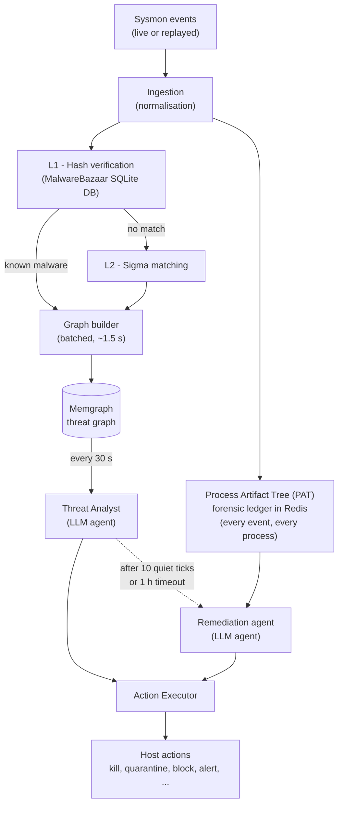

# EDR Proof of Concept — Sysmon, Graph Correlation and LLM-assisted Response


> [!IMPORTANT]
> **Academic project.** This repository started as  the result of a *Projet de Fin d'Année* (PFA). It is a **proof of concept (PoC)** built to explore ideas, **not a production security product**. Read the [Limitations](#limitations-and-scope) before running anything.

---

## 1. Aim of the project


This PoC explores one question: **can we combine classic detection (hashes, Sigma rules) with a *graph of process behaviour* and LLM agents that reason over that graph, to detect and contain an attack?**

The goal of this project is to explore a question  **can we combine classic detection (hashes, Sigma rules) with a *graph of process behaviour* and LLM agents that reason over that graph, to detect and contain an attack?**

In short, the system:

1. **Collects** [Sysmon](https://learn.microsoft.com/en-us/sysinternals/downloads/sysmon) events from a Windows machine (live), or **replays** a recorded Sysmon dataset.
2. **Checks hashes** against known malware (MalwareBazaar data).
3. **Matches events against [Sigma](https://github.com/SigmaHQ/sigma) rules** and gives each event a score.
4. **Builds a threat graph** (in Memgraph) where processes, files, network connections and registry keys are linked and scored.
5. Runs an **LLM "Threat Analyst"** every 30 seconds that reads the suspicious part of the graph and proposes containment actions.
6. Runs an **LLM "Remediation agent"** that investigates the full incident afterwards and proposes cleanup actions.
7. Executes the actions through an **Action Executor**.
8. Keeps a complete **forensic ledger** of every process in Redis, used as ground truth by the remediation agent.

---


The aim is a *logically coherent* end-to-end pipeline — detect → correlate →
analyse → respond → remediate — not detection performance or hardening.

---

## 2. Architecture



- The **left branch** (Ingestion → L1 → L2 → Graph) is the *fast path*: it runs on every event and only produces scores.
- The **Threat Analyst** does not see raw events. It periodically queries the graph for processes whose score crossed a threshold, then asks the LLM to judge them.
- The **PAT** is separate from the graph: the graph is sparse and scored, the PAT stores *everything* (7-day TTL). The remediation agent uses the PAT to rebuild the whole story.
- A **known-malware hash (L1)** skips Sigma for that event and goes straight to the graph with a very high score.

### Layers

| Layer | Module | What it does |
|---|---|---|
| **L1** Hash reputation | `src/detection/l1_hash_check/` | Whitelist → local SQLite DB of MalwareBazaar hashes → MalwareBazaar API (unknown hashes). A hit is CRITICAL. |
| **L2** Sigma | `src/detection/l2_sigma_detection/` | Loads Sigma rules (pySigma + a local matcher), maps matches to ATT&CK techniques/tactics and a severity score. |
| **L3** YARA | `src/detection/l3_yara_scanner.py` | Placeholder only. Disabled (`enable_l3=False`). |
| **Graph** | `src/graph/` | Writes scored events to Memgraph. Process *templates* (image + parent + cmdline + user) and *instances* (GUID). Scores are sums; children inherit 40 % of a scored parent. Schema: `schema_definition.cypher`. |
| **L4** ThreatAnalyst | `src/detection/l4_llm_detection/` | Background thread (30 s tick). Picks nodes above the score threshold, extracts a bounded sub-graph, asks the LLM analyst for a verdict and actions, stamps the result on the graph and in `actioned_nodes.jsonl`. |
| **PAT** | `src/PAT/pat_builder.py` | Redis-backed, append-only record of every process (identity, actions, children, file/IP/DNS indexes). Never pruned by score. |
| **Remediation** | `src/remediation/` | Reads the analyst's actioned nodes, clusters them into incidents, builds lineage and blast radius from the PAT, runs a Gemini tool-calling (ReAct) agent and produces a report plus cleanup actions. |
| **Response** | `src/core/response.py` | The actual actions: process termination, file quarantine/deletion, registry/scheduled-task removal, IP/domain blocking, host isolation, shutdown, patching, identity revocation, alerting. Includes a protected-resources list (`data/windows_protected_resources.json`). |

**Sysmon events handled by the graph:** 1, 2, 3, 5, 6, 7, 8, 10, 11, 12, 13, 14, 15, 22, 23, 25.

---


## 3. Requirements

> Use a **disposable Windows VM**. Replay mode is the safest way to start.


- **Windows 10/11** (uses `pywin32`, `winreg`, `schtasks`, Windows Event Log) with **Sysmon** installed (for live mode)
- **Python 3.10+**
- **Redis** reachable on `localhost:6379` (PAT and Sigma engine)
- **Memgraph** reachable on `localhost:7687` (override with `MEMGRAPH_HOST` / `MEMGRAPH_PORT`)
- A **Google Gemini API key** (L4 analyst and remediation agent)
- Optional: a **MalwareBazaar API key** (L1 online lookups)

```bash
python -m venv venv
venv\Scripts\activate
pip install -r requirements.txt
```

### Environment variables (`.env` is supported)

| Variable | Required | Purpose |
|---|---|---|
| `GEMINI_API_KEY` | yes | LLM analyst + remediation agent (the remediation module refuses to import without it) |
| `MALWAREBAZAAR_API_KEY` | no | L1 online hash lookups |
| `EDR_ACTION_MODE` | no | `approval` (default) or `automatic` |
| `MEMGRAPH_HOST`, `MEMGRAPH_PORT` | no | default `localhost`, `7687` |


---

## 4. Running

Run everything **from the repository root** (several paths are relative to it).

```bash
# start the dependencies
#   Redis      → localhost:6379
#   Memgraph   → localhost:7687
set GEMINI_API_KEY=your_key

python -m src.core.agent
```

Behaviour is controlled by flags at the top of `src/core/agent.py`:

| Flag | Default | Meaning |
|---|---|---|
| `READ_FROM_FILE` | `True` | `True` = **replay** a Sysmon log file; `False` = **live** Sysmon subscription |
| `LOG_REPLAY_FILE` | `tests/logs_datasets/apt17.txt` | replay source |
| `REALTIME_REPLAY` | `True` | replay at the original event pace; `False` = as fast as possible |
| `BATCH_GRAPH`, `BATCH_SIZE`, `BATCH_TIMEOUT` | `True`, 100, 1.5 s | batched Memgraph writes |

**Replay mode:** after the last event the agent waits until the ThreatAnalyst is
idle (bounded timeout), then runs one remediation sweep. **Live mode:** remediation
is triggered after a number of quiet analyst ticks. `Ctrl+C` stops the agent and
shuts the analyst down cleanly.

### Approving queued actions

```bash
python -m src.detection.l4_llm_detection.approval_response_executor
```

For each queued finding you can approve all, decide per action, or skip. Executed
findings are recorded in `approvals_resolved.jsonl`; the queue file is never rewritten.


---

## 5. Safety model for response actions

Default mode is **`approval`**: nothing destructive runs by itself. Proposed actions
are written to `pending_approvals.jsonl` and run only after an operator approves them.

In **`automatic`** mode actions run immediately, **except** the following, which are
always queued for approval because they are host-wide or account-wide and hard to undo:

`shutdown` · `host_isolation` · `patching` · `identity_revocation`

(The remediation action `reimage_host` maps to `shutdown`, so it is covered as well.)
Other protections: a protected files/processes list, validation of scheduled-task
names before `schtasks /delete` (run without a shell), and a rule that scheduled
tasks are removed with `schtasks`, not by deleting registry keys.

> **Do not use `automatic` mode together with log replay.** Replayed GUIDs/PIDs/paths
> come from another machine's history; resolving them against your live host can hit
> unrelated processes or files.

### Files produced at runtime (working directory)

| File | Written by | Content |
|---|---|---|
| `actioned_nodes.jsonl` | ThreatAnalyst | nodes/actions the analyst stamped; input of remediation |
| `pending_approvals.jsonl` | analyst, remediation, executor | queued findings awaiting approval |
| `approvals_resolved.jsonl` | approval tool | append-only log of executed findings |
| `action_log.jsonl` | ActionExecutor | every executed/queued action and its result |
| `results.json` | agent | per-event detection output (debug; large, not strictly valid JSON) |
| `logs/edr_agent_*.log` | agent | console + log output |

---

## 6. Repository layout

```
src/
  core/         agent (orchestrator), pipeline, ingestion, event_watcher, response, config, utils
  detection/    l1_hash_check/  l2_sigma_detection/  l3_yara_scanner.py  l4_llm_detection/
  graph/        Memgraph writers + schema_definition.cypher
  PAT/          Process Artifact Tree (Redis)
  remediation/  collector, grouper, lineage, context builder, LLM agent, tools, report models
data/           windows_protected_resources.json (+ local DBs, git-ignored)
tests/          log_replay, evtx converter, regression tests
tools/          L1 database and API helper scripts
```

---

## 7. Limitations and scope

This is a proof of concept; known simplifications:

- **Windows-only**, single host; no agent/server split, no authentication, no tamper
  protection, no encrypted storage of findings.
- **LLM output is non-deterministic** and untrusted. It is bounded by the approval
  gate, the approval-only action list, validation and protected-resource checks, but
  none of this has been security-reviewed.
- **Remediation only starts from process (GUID) actions.** Findings that contain only
  file or network actions are not picked up by the remediation sweep.
- **L3 (YARA) is notyet integrated.**
- Hosts and ports for Redis are constants in the code; Memgraph is configurable.
- Evaluation was done on replayed datasets (e.g. APT17-style scenarios), not on a
  production fleet; no performance or false-positive claims are made.
- `results.json` is a debug dump.

---

## 8. Acknowledgements 
[Sysmon](https://learn.microsoft.com/en-us/sysinternals/downloads/sysmon) (Microsoft Sysinternals), [Sigma](https://github.com/SigmaHQ/sigma) rules, [MalwareBazaar](https://bazaar.abuse.ch/) (abuse.ch), [Memgraph](https://memgraph.com/), [Redis](https://redis.io/), and Google Gemini.

